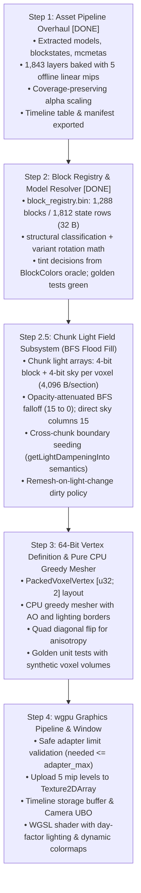

# Voxel Engine Specification & Reference Oracle (Clean-Room Minecraft 26.3)

This document contains mathematically verified invariants, physics equations, graphics formats, and data-oriented layouts extracted from vanilla Minecraft 26.3 client bytecode (`minecraft-26.3-client.jar`).

---

## 1. Physics & Movement Dynamics (20 Hz Fixed Tick)

All simulation ticks run at a fixed $\Delta t = 0.05\text{ s}$ (20 ticks per second).

### Core Constants
- **Base Gravity**: $0.08\text{ blocks/tick}^2$ (`Attributes.GRAVITY = 0.08`)
- **Base Jump Impulse**: $0.42\text{ blocks/tick}$ (`Attributes.JUMP_STRENGTH = 0.42F`)
- **Sprint Jump Boost**: $+0.2\text{ blocks/tick}$ added horizontally in facing direction:
  $$\Delta v_x = -\sin(\theta) \cdot 0.2, \quad \Delta v_z = \cos(\theta) \cdot 0.2$$
- **Vertical Air Drag**: $0.98\text{ per tick}$ ($0.9800000190734863$)
- **Terminal Fall Velocity**: $\approx 3.92\text{ blocks/tick}$ ($\frac{0.08}{1.0 - 0.98}$)
- **Horizontal Air Drag**: $0.91\text{ per tick}$
- **Default Block Friction**: $0.6\text{ (air/standard blocks)}$
- **Effective Ground Friction**: $0.6 \times 0.91 = 0.546\text{ per tick}$
- **Ice Friction**: $0.98 \implies \text{effective friction } = 0.98 \times 0.91 = 0.8918$
- **Ground Acceleration Factor**:
  $$\text{speed\_factor} = \begin{cases} 
  \frac{0.216}{\mu_{\text{block}}^3} & \text{if } \mu_{\text{block}} > 0.6 \\
  1.0 & \text{otherwise}
  \end{cases}$$
- **Fluid Drag**:
  - Water: $0.80\text{ velocity multiplier}$
  - Lava: $0.50\text{ velocity multiplier}$

### Player Dimensions & Bounding Box
- **Width**: $0.6\text{ blocks}$
- **Height (Standing)**: $1.8\text{ blocks}$
- **Eye Height**: $1.62\text{ blocks}$
- **Max Step-Up Height**: $0.6\text{ blocks}$ (`Attributes.STEP_HEIGHT = 0.6`)
- **Relative AABB**: $[-0.3, 0.0, -0.3]$ to $[0.3, 1.8, 0.3]$

### Collision Resolution Order (AABB Sweep)
Collision must be resolved axis-by-axis against neighboring voxel bounding boxes. To prevent corner clipping and sticky corners, modern 26.3 uses dynamic axis ordering:
$$\text{Axis Order} = \begin{cases}
[Y, Z, X] & \text{if } |\Delta x| < |\Delta z| \\
[Y, X, Z] & \text{otherwise}
\end{cases}$$

---

## 2. Terrain Generation & Synthesis (Simplex / Perlin)

- **Simplex 2D Skew Factors**:
  $$F_2 = \frac{\sqrt{3} - 1}{2} \approx 0.3660254037844386$$
  $$G_2 = \frac{3 - \sqrt{3}}{6} \approx 0.21132486540518713$$
- **Standard Deviation Normalization**: $0.42544$
- **Output Range**: Symmetrical $[-2.0, 2.0]$

---

## 3. GPU Texture 2D Array Architecture (`D2Array`)

Rather than a single stitched 2D atlas with bleeding seams, the engine uses a hardware `wgpu::TextureDimension::D2` array texture (`texture_2d_array<f32>` in WGSL):

- **Format**: `wgpu::TextureFormat::Rgba8UnormSrgb`
- **Resolution per Layer**: $16 \times 16\text{ pixels}$
- **Mipmap Levels**: 5 offline levels ($16\times 16 \to 8\times 8 \to 4\times 4 \to 2\times 2 \to 1\times 1$)
  - Downsampled strictly in linear color space ($\text{sRGB} \to \text{linear} \to \text{premultiplied box filter} \to \text{sRGB}$) to eliminate gamma darkening on distant surfaces.
  - Cutout textures use coverage-preserving alpha scaling (Rune Skovbo Johansen's scale factor) to prevent foliage/sapling silhouettes from thinning or vanishing at distance.
- **Layer Budget**:
  - **Static Textures**: 1,246 unique layers.
  - **Animated Frames**: 54 animated textures expanded to all 594 sequential frames.
  - **Base Total**: $1,246 + 594 = 1,840\text{ layers}$.
  - **Pre-Tinted Baked Layers**: 3 duplicate layers for fixed foliage tints (`birch_leaves_tinted` at `0x80A755`, `spruce_leaves_tinted` at `0x619961`, `lily_pad_tinted` at `0x208030`).
  - **Grand Total**: **1,843 layers** (fits comfortably within the 11-bit addressable limit of 2,048 layers).
- **VRAM Footprint**: $\approx 2.40\text{ MB}$ total for all 1,843 layers across all 5 mip levels.
- **Sampler Addressing**: `wgpu::AddressMode::Repeat` tiles greedy-meshed quads naturally across UV coordinates without manual shader modulo or seam artifacts.
- **Non-16px Asset & Flowing Fluid Handling**:
  - 32×32 static assets (signs, shelves) and 64×64 beds are downsampled to 16×16 via 2×2 linear box filtering with cutout preservation.
  - Flowing fluids (`water_flow` 32×1024, `lava_flow` 32×512) have each individual 32×32 frame linearly downsampled to 16×16, preserving all animation frames without distortion.

### Animation Timeline Subsystem
Vertices bake only the base layer index of a texture. All animation timing is resolved on the GPU via a flat timeline buffer in a storage buffer:
- Global `timeline: array<u32>` storing sequences of relative frame indices expanded per tick duration.
- Per-texture lookup: `(timeline_offset, timeline_len, interpolate)`.
- Shader calculation:
  $$\text{frame} = \text{timeline}[\text{timeline\_offset} + (\text{current\_tick} \pmod{\text{timeline\_len}})]$$
  $$\text{layer} = \text{base\_layer} + \text{frame}$$
- Produces tick-accurate, non-linear animation cycles (e.g. `prismarine`, `lava_still`) with zero CPU vertex buffer updates.

---

## 4. Sub-Chunk & Vertex Bit-Packing Specification

### Sub-Chunk Dimensions
- $16 \times 16 \times 16 = 4,096\text{ voxels}$.
- Coordinates span $X \in [0, 16], Y \in [0, 16], Z \in [0, 16]$ (17 corner vertices per axis).

### Vertex Packing: Exactly 64 Bits (`[u32; 2]` / 8 Bytes)
WebGPU and `wgpu` require `arrayStride` to be a multiple of 4 bytes. An 8-byte vertex is hardware-optimal (`R32G32_Uint`), cacheline-aligned (8 vertices per 64-byte cache line), and accommodates full smooth lighting and material attributes.

```
Word 0 (u32): Geometry & Position
 0        4 5        9 10      14 15       17 18       19 20                  31
+----------+----------+----------+-----------+-----------+----------------------+
|  X (5b)  |  Y (5b)  |  Z (5b)  | Normal(3b)| Tint (2b) |     Spare (12b)      |
|  0..=16  |  0..=16  |  0..=16  |   0..5    |   0..3    | (UV rot / flags)     |
+----------+----------+----------+-----------+-----------+----------------------+

Word 1 (u32): Lighting & Material
 0             3 4             7 8       9 10                 20 21           31
+---------------+---------------+---------+--------------------+----------------+
| BlockLight(4b)| SkyLight (4b) | AO (2b) | Base Layer (11b)   |   Spare (11b)  |
|     0..15     |     0..15     |  0..3   |      0..2047       |                |
+---------------+---------------+---------+--------------------+----------------+
```

#### Word 0 Layout:
- **Bits 0..4 (5 bits)**: Local vertex X coordinate ($0..16$).
- **Bits 5..9 (5 bits)**: Local vertex Y coordinate ($0..16$).
- **Bits 10..14 (5 bits)**: Local vertex Z coordinate ($0..16$).
- **Bits 15..17 (3 bits)**: Face Normal direction ID (`0`: $+Y$, `1`: $-Y$, `2`: $+Z$, `3`: $-Z$, `4`: $+X$, `5`: $-X$).
- **Bits 18..19 (2 bits)**: Dynamic Colormap Tint Mode (`0`: None, `1`: Grass colormap, `2`: Foliage colormap, `3`: Water colormap).
- **Bits 20..31 (12 bits)**: Spare / UV rotation flags (e.g. 90° log bark rotation).

#### Word 1 Layout:
- **Bits 0..3 (4 bits)**: Block Light level ($0..15$).
- **Bits 4..7 (4 bits)**: Sky Light level ($0..15$).
- **Bits 8..9 (2 bits)**: Ambient Occlusion level ($0..3 \implies 0.2, 0.45, 0.7, 1.0$).
- **Bits 10..20 (11 bits)**: Texture array base layer index ($0..2047$).
- **Bits 21..31 (11 bits)**: Spare.

### Day-Factor Lighting Invariant
- **No World Re-meshing on Sunset**: Sky light ($0..15$) and block light ($0..15$) are static spatial values baked into Word 1 of vertices.
- **Fragment Shader Lighting Fusion**: A frame uniform `day_factor` ($\in [0.0, 1.0]$) scales the ambient sky contribution in the fragment shader:
  $$\text{Light}_{\text{final}} = \max(\text{block\_light\_color} \times \text{block\_light}, \text{sky\_light\_color} \times (\text{day\_factor} \times \text{sky\_light})) \times \text{AO\_curve}$$
- Day/night progression alters only the uniform scalar; terrain geometry remains 100% untouched.

### Binary Greedy Meshing Merging Invariants
A face quad may merge across adjacent coplanar voxels if and only if:
1. They share identical base texture layer IDs.
2. They share identical face normals.
3. They share identical tint modes.
4. They share identical 4-corner Ambient Occlusion levels.
5. They share identical 4-corner Sky Light and Block Light levels.

### Dynamic Quad Diagonal Flipping (Anisotropy Prevention)
To eliminate diagonal interpolation creases caused by opposing AO and lighting gradients across quad vertices:
$$\text{Gradient}_{02} = (AO_{00} + AO_{11}) + (Light_{00} + Light_{11})$$
$$\text{Gradient}_{01} = (AO_{01} + AO_{10}) + (Light_{01} + Light_{10})$$
$$\text{Triangulation} = \begin{cases}
[1, 2, 3, 3, 0, 1] & \text{if } \text{Gradient}_{02} < \text{Gradient}_{01} \\
[0, 1, 2, 2, 3, 0] & \text{otherwise}
\end{cases}$$

---

## 5. Phase 2 Subsystem Architecture & Dependency Roadmap

### Step 2 (DONE): Offline Block Registry Bake

`crates/asset_pipeline/src/bin/registry_baker.rs` bakes `assets/registry/block_registry.bin`
from `assets/blockstates/` + `assets/models/block/` + `texture_manifest.json`.
The engine loads this as a flat read-only array; it never parses model JSON.

Binary format (little-endian, deterministic — all maps sorted):

| Section | Layout |
|---|---|
| Header (32 B) | `magic "VXRG"` + 7 × u32: `version=1`, `block_count`, `state_count`, `names_len`, reserved ×3 |
| Names blob | UTF-8 block names, concatenated; relative offsets |
| Block index | 20 B/entry: `name_off u32`, `name_len u32`, `state_start u32`, `state_count u32`, `mesh_type u8`, `has_variants u8`, `pad u16` |
| State rows | 32 B `BlockStateEntry` each: `faces[6] FaceInfo` (4 B: `base_layer u16`, `tint_mode u8`, `uv_rot u8`), `mesh_type u8`, `is_opaque u8`, `is_solid u8`, `light_emission u8`, `light_filter u8`, `pad[3]` |

Face slot order: `0 = +Y (UP), 1 = -Y (DOWN), 2 = +Z (SOUTH), 3 = -Z (NORTH), 4 = +X (EAST), 5 = -X (WEST)`.

Classification (`mesh_type`): 0 Empty · 1 Cube · 2 Cross · 3 Fluid · 4 Complex.
Cube = every resolved element is a full `[0,0,0]-[16,16,16]` prism with cullface'd faces and
cullface union covering all 6 directions (handles multi-element stacks like grass_block;
their second "overlay" element is dropped in v1 — base texture wins per cullface).
Empty = entity-rendered blocks (banners, chests, shulkers, skulls, air); they carry property
bytes but no faces.

Variant→face mapping: blockstate variant `x`/`y` are **degrees**, applied
`Rx(x)∘Ry(y)` (Rx first — validated by golden test: `oak_log` axis=x ends on ±X, axis=z
ends on ±Z with `uvlock`-free rotation). Variant values may be dict-form or array-form
(26.3 randomized lists; first entry wins). Face-key fallback covers models omitting
`cullface` on full prisms (piston family).

Tint decisions (provenance: `BlockColors::createDefault()`, snapshot oracle, verified
2026-10-22; constants birch 0x80A755 → layer 1840, spruce 0x619961 → 1841, lily-pad
in-world 0x208030 → 1842):

- `tint_mode 1` grass: fern, short_grass, potted_fern, bush, tall_grass, large_fern,
  grass_block, sugar_cane *(sugar_cane PENDING-VERIFY: BlockTintSources.sugarCane() may
  not equal the pure grass palette)*
- `tint_mode 2` foliage: oak/jungle/acacia/dark_oak leaves, vine, mangrove_leaves.
  **pale_oak_leaves is NOT tinted** (unregistered — fixed texture).
- `tint_mode 3` water: water, bubble_column (fluid rows only).
- `tint_mode 4` dry_foliage: leaf_litter — carried by Word 1 spare bit 0 at mesher packing
  time (registry holds the value; the vertex enum has only 2 bits for 0..3).
- `pink_petals`/`wildflowers` are **NOT grass-tinted** in v1 (BlockColors registers
  `[BLANK, grass]`; petals texture is fixed color; stem-layer tint dropped with cross v1).
- Fixed tints bake directly to pre-tinted layers 1840–1842 with `tint_mode = 0`.

Property bytes v2 (release-jar verified 2026-10-22; oracle table
`assets/registry/block_properties.json` ← `property_extractor.rs` ← decompiled
`Blocks.java`; baker/tests consume the JSON only, never the decompiles):

- **Emission is per-state.** `litBlockEmission(N)` in `Blocks.java` means
  `state.getValue(LIT) ? N : 0`. Exact per-variant rows bake for variant-expanded
  mesh types (furnace/blast_furnace/smoker lit 13·unlit 0, redstone_lamp 15,
  redstone_ore+deepslate 9, redstone_torch 7, candle_cake 3 lit). State-driven
  kinds: `lit_scale` (candle: lit ? 3·CANDLES — CandleBlock.java:42),
  `alive_scale` (sea_pickle: waterlogged ? 3+3·PICKLES), `prop_value`
  (light block = its `level`), `prop_scale` (respawn_anchor = floor(charge/4·15)),
  `prop_map` (vault 6/12 by state; trial_spawner 0/4/8). Weathering copper bulbs:
  lit 15/12/8/4 by oxidation (copper_…/exposed/…/oxidized).
- Constants: lava(15; dampening nonetheless **1**), glowstone/sea_lantern/
  shroomlight/lantern/jack_o_lantern/conduit/beacon/end_portals/froglights 15;
  all torch families 14 (soul 10, redstone lit 7, copper 14); fire 15 / soul_fire 10;
  crying_obsidian 10; nether_portal 11; magma 3; end_portal_frame 1;
  amethyst family 5/4/2/1; sculk sensor 1 / catalyst 6; dragon_egg 1;
  brown_mushroom 1; brewing_stand 1; enchanting_table 7; ender_chest 7;
  glow_lichen 7 (approximation — hasAnyFace λ collapses on the single row);
  glowstone dampening 15 (occludes).
- **Dampening** (attenuation per step — `BlockBehaviour.java:274-280` +
  `LightEngine.getOpacity = max(1, dampening)`): derived rule
  `solidRender ? 15 : propagatesSkylightDown ? 0 : 1` over the registry's
  classification + occlusion set; class overrides harvested: leaves 1 /
  tinted_glass 15; `skylight` set (TransparentBlock family: glass+stained glass,
  grates) → 0. Results: opaque cubes 15; **all fluids incl. lava 1** (the old
  "lava blocks light" value was pre-1.14 folklore; `LiquidBlock.propagatesSkylightDown
  = false` + `.liquid()` ⇒ 1, LightEngine.java:79-81); ice/frosted 1 (no dampening
  override — `HalfTransparentBlock` path) BUT **packed_ice/blue_ice 15** (occluding
  full prisms ⇒ solidRender; no `noOcclusion()` in their registrations);
  slime/honey 1; glass family 0; tinted_glass 15; cross/complex/empty 0.
- `is_opaque` now means canOcclude (full prism ∧ not in `no_occlusion`): glass
  family, leaves, ice/frosted, slime/honey, tinted_glass bake 0. Mesher culling and
  dampening share the same set (both hinge on `noOcclusion()`).
- Canonical-cube rule refined: a model whose elements contain one covering full 16³
  prism (slime/honey inner-juice shell) classifies CUBE; interior texture elements
  drop (same approximation as grass_block overlays).

Step 2.5 invariants for the light field (release-jar mechanics):
- Direct sky column: `(x,z)` columns above the first non-propagating block get
  sky=15 with zero attenuation (`SkyLightEngine` lowestSourceY path).
- Lateral/other propagation: BFS with per-step decrement
  `max(1, dampening(destination))`.
- Section storage: **4,096 B** per 16³ section, one byte per voxel
  `(sky << 4) | block`.
- `getRawBrightness` (LevelLightEngine.java:142-146) is
  `max(blockLight, skyLight − skyDampen)` — a dimension-ambient *subtraction*, NOT
  a day-factor multiply. The shader `day_factor` design mimics the client
  `LightTexture` day ramp; cite it as a client approximation in SPECS.
- Shape gate: `LightEngine.getLightDampeningInto` blocks light 16 when merged
  occlusion faces close the boundary — engages only `useShapeForLightOcclusion`
  blocks (stairs/panes; our complex-skip set) — carried to the Step 2.5 boundary
  propagator when those mesh.
- Section voxel index: `(y << 8) | (z << 4) | x` (x fastest, y slowest) — pinned
  2026-10-22 with the light-field module; mesher and world-gen consume the same order.
- World cover: 24 sections ⇒ Y ∈ [−64, 320); engine constants `MIN_Y = -64`,
  `SECTION_COUNT = 24`. (Vanilla pads `getLightSectionCount() = sections + 2`
  — LevelLightEngine.java:153-155; we skip the padding in v1 but must emulate its
  semantics: light queries at y ≥ MAX_Y yield **sky 15 / block 0** (the vanilla
  padding section above the top is full sky — the mesher's y=319 top faces read
  `sky=15`), y < MIN_Y yields 0/0.)
- State ids: BFS/mesher lookups use raw registry state ids from the bin (see
  approximation 5); no engine-side offset, and lookups by block name in tests.

Known v1 approximations (Step 3/4 refinement list):
1. `uv_rot` uses only the model face's own `rotation` field; blockstate twist with
   `uvlock` re-alignment is not computed (affects mostly complex blocks — fences/stairs).
2. Multi-element cubes keep the FIRST element's texture per cullface (grass_block side
   overlay, slime/honey inner-shell texture dropped).
3. Fluids emit ONE state row regardless of level variants (placement addressing will
   expand when block IDs land).
4. `farmland` (15/16-height top prism) and other near-full prisms classify Complex and
   are mesher-skipped until Step 3 defines near-full handling.
5. `air`/`cave_air`/`void_air` **are** registered rows (air family bakes `MESH_EMPTY`,
   emission 0 / filter 0 / opaque 0 — `assets/blockstates/air.json` is among the 1,288
   blockstates). Engine voxels carry raw registry state ids — **no sentinel/offset**:
   state id `0` is `acacia_button`'s first row, which is *incidentally* all-zero for
   light purposes (an id-0 zero-assert is a vacuous test — always look rows up by
   block name). Unregistered world-voxel ids resolve to `air`'s state id at
   world-import time (Step 5).
6. Complex/Empty blocks stay single-row: LIT-conditioned emitters there (torches,
   campfires, trial/vault/spawner, candle) collapse to always-lit values pending
   light-relevant state expansion ( extractor records carry the predicates; see
   Step 2.5 plan). Crescent emitters like glow_lichen/sea_pickle collapse to their
   representative value with `decl` provenance in the oracle table.
7. Waveforms/variants like respawn_anchor/map from state maps; an unknown
   enumerated value falls back to 0, not a crash.
8. Light reload on edit recomputes the whole chunk column (24 sections) with
   cross-chunk boundary seeding from neighbour light; vanilla's incremental
   add/remove two-queue BFS is deferred until profiling demands it.

## Step 3: Pure CPU Greedy Mesher Architecture & Invariants (pinned 2026-10-22)

### 1. Per-State Registry Consumption (Zero Hardcoded Tables)
- Engine voxels store raw 16-bit state IDs (`0..=1811`).
- Never assume `state_id == 0` is air (`0` is `acacia_button`; `air` is row 23).
- All decisions query `BlockStateEntry` through `registry.rs`.
- **Renderable Candidate Predicate**:
  A voxel emits cubic faces if:
  `entry.mesh_type == MESH_CUBE` (1).
  Non-renderable / air blocks have `entry.mesh_type == MESH_EMPTY` (0) (air, cave_air, void_air, and entity-rendered blocks).
  Individual face emission checks `entry.faces[face].base_layer < 2048`.

### 2. Culling Semantics (`is_opaque == canOcclude`)
- Face culling checks whether the adjacent neighbor along face normal `N` occludes this face:
  1. **Opaque Neighbor (`neighbor.is_opaque == 1`)**:
     Always CULLS the face. The neighbor is a full solid block with `canOcclude == true` (stone, dirt, packed_ice, etc.).
  2. **Empty Neighbor (`neighbor.mesh_type == MESH_EMPTY`)**:
     NEVER culls the face. Air/empty blocks leave the face fully exposed.
  3. **Adjacent Non-Opaque Blocks (`neighbor.is_opaque == 0`)**: decompile-verified
     identity rule — `HalfTransparentBlock.skipRendering` culls iff
     `neighborState.is(this)` (same block; `HalfTransparentBlock.java:13-16`), the
     base rule likewise culls same-state; `LeavesBlock.java:49-51` overrides for
     the leaves family. Block identity comes from the sorted-index reverse
     state→block lookup (no id stored in rows; properties-bearing transparent
     blocks keep per-state refinement as a note, not v1). The family list —
     leaves incl. `pale_oak_leaves` (NOT foliage-tinted in BlockColors: the
     `tint_mode == 2` proxy wrongly culled it; jar shows no dedicated
     `PaleOakLeaves` class ⇒ plain `LeavesBlock` registration — confirm during
     extraction) — is harvested by `property_extractor` from the registration
     classes into `block_properties.json` and baked into row `pad[0]` as a
     `cull_class` byte (row stays 32 B). Never hand-typed in engine or baker.
     Encoding: 0 = none (opaque handled by `is_opaque`), 1 = leaves family,
     2 = water, 3 = lava, >=4 = per-block transparent identity ids (glass,
     tinted_glass, each stained-glass color separately, ice, frosted_ice,
     blue_ice, slime_block, honey_block, copper-grate family).
     VERIFIED (review 2026-10-22): `waxed_*_copper_grate` rows resolved via
     targeted decompile of `WeatheringCopperCollection.java` (8 variants discovered
     programmatically) -> harvested into `cull_classes`, `no_occlusion`, and `skylight`
     maps; coverage report embedded in `block_properties.json` confirms 1,286/1,288
     blocks harvested from `Blocks.java` (only `item_frame` and `glow_item_frame` absent).
     - **Same non-opaque block** (glass|glass, same stained-glass color,
       ice|ice, slime|slime, same fluid water|water / lava|lava): CULL.
     - **Different blocks** (water vs lava, glass vs ice, red vs blue stained
       glass): RENDER both faces — the earlier `MESH_FLUID && MESH_FLUID` rule
       over-culled water|lava boundaries.
     - **Leaves family (`cutoutLeaves = true` default)**: never skip against any
       LeavesBlock — render all internal canopy faces.

### 3. 8-Neighbor Halo Access & Scheduling Policy
- **18×18×18 Padded Halo**: Meshing a 16³ section with 4-corner AO and vertex lighting requires sampling `x, y, z ∈ [-1, 16]`.
  - Cardinal faces read from the 4 cardinal horizontal neighbors: West (`-X`), East (`+X`), North (`-Z`), South (`+Z`).
  - Corner vertices at `(0,0), (16,0), (0,16), (16,16)` read corner voxels AND light at `(x, z) ∈ {(-1,-1), (16,-1), (-1,16), (16,16)}`, which reside in the 4 diagonal neighbor chunks: North-West (`NW`), North-East (`NE`), South-West (`SW`), South-East (`SE`).
  - Vertical limits: `y >= 320` clamps to sky 15 / block 0 / air; `y < -64` clamps to sky 0 / block 0 / air.
- **Neighborhood Input**:
  A `SectionHalo` buffer holding `voxels: [u16; 18 * 18 * 18]` (~11.6 KB) and `light: [u8; 18 * 18 * 18]` (~5.8 KB) extracted once per section before sweeping slices. Total footprint (~17.5 KB) resides fully in CPU L1 data cache, eliminating pointer chasing and chunk bounds branches in inner loops.
- **Missing-Neighbor & Dirty Remesh Policy** (reconciled 2026-10-22 — this
  section replaces the fallback approach and restores the wait-for-8 contract):
  - A section meshes ONLY when all 8 horizontal neighbor columns (voxels AND
    light) are available; a missing neighbor queues a remesh for that section
    on arrival (vanilla `SectionRenderDispatcher` readiness behavior). The
    air/sky fallback exists ONLY for out-of-world Y clamps (`y >= 320` /
    `y < -64`), never for horizontal chunk edges or corners.
  - When a chunk column completes lighting or voxel modification, it queues dirty remesh flags for:
    - Its own 24 sections.
    - The adjacent 1-voxel border sections of its 4 cardinal neighbors (`W, E, N, S`).
    - The corner columns of its 4 diagonal neighbors (`NW, NE, SW, SE`).

### 4. 4-Corner AO Formula, Sealed-Corner Light Rule, & Quad Diagonal Flip
- **4-Corner AO Formula**:
  For face normal `N` and tangential axes `U, V`, corner `(u, v)` samples `side1 = N + u·U`, `side2 = N + v·V`, and `corner = N + u·U + v·V`.
  Let `s1 = side1.is_opaque`, `s2 = side2.is_opaque`, `c = corner.is_opaque`.
  $$\text{ao} = \begin{cases} 0 & \text{if } s1 = 1 \land s2 = 1 \\ 3 - (s1 + s2 + c) & \text{otherwise} \end{cases}$$
- **Sealed-Corner Light Rule** (decompile-verified: `BlockModelLighter.java:61-122`
  + `LightCoordsUtil.smoothBlend` at LightCoordsUtil.java:66-88; for the v1
  canonical-cube set, "not light-permeable" ≡ `is_opaque == 1`):
  - `center` = the light of the cell ONE STEP ALONG THE NORMAL
    (BlockModelLighter.java:117-122 — cubic faces sample `basePosition +
    direction`), not the face's own cell.
  - Sealed corner: when BOTH of the vertex's side cells are not
    light-permeable, the corner sample is substituted by the **first side's**
    light+shade (BlockModelLighter.java:71-115) — NOT by center.
  - Substitution is LIGHT-VALUED, never opacity-valued: when `center` has
    sky > 2 or block > 2, a sample whose packed light coords == 0 is fully
    replaced by `center`'s coords, and a sample whose sky == 0 borrows
    `center`'s sky nibble. Opaque-but-bright cells (glowstone wall) keep their
    own 15 and bleed through corners exactly as vanilla does.
  - Deterministic integer blend, vanilla-exact (LightCoordsUtil.java:87):
    $$\text{vertex\_light} = \left(\text{center} + \text{side1'} + \text{side2'} + \text{corner'}\right) \gg 2$$
    — pure floor average, NO +2 rounding bias; the shift is shared across sky
    and block nibbles (each 4-bit, so 4×15 >> 2 == 15 exactly).
- **Quad Diagonal Flip**:
  For quad vertices `v0 (0,0), v1 (1,0), v2 (1,1), v3 (0,1)`:
  Compute diagonal brightness sums:
  $$d_{02} = \text{brightness}(v0) + \text{brightness}(v2), \quad d_{13} = \text{brightness}(v1) + \text{brightness}(v3)$$
  where $\text{brightness}(v) = (\text{ao} \ll 5) + \max(\text{sky}, \text{block})$.
  - If $d_{02} > d_{13}$: triangulate as $(v0, v1, v2)$ and $(v0, v2, v3)$ (split $v0 - v2$).
  - Otherwise: triangulate as $(v1, v2, v3)$ and $(v1, v3, v0)$ (split $v1 - v3$).
  This eliminates anisotropic diagonal shadow seams.
- **Approximation labels (vs `BlockModelLighter.java:181-194`):** the 3-level
  integer AO (both-sides→0, else `3 − (s1+s2+c)`) stands in for vanilla's float
  shade-brightness averages `(s3+s0+sCorner+sCenter)·0.25`; the flip comparator
  `(ao << 5) + max(sky, block)` stands in for vanilla's smooth light+shade sum
  comparison — direction now pinned to the Sodium reference implementation
  from the installed instance (`ModelQuadOrientation.orientByBrightness`
  bytecode, read 2026-10-22): `d02 > d13` → NORMAL (split `v0 − v2`);
  `d02 < d13` → FLIP (split `v1 − v3`); on an exact tie, FLIP iff
  `sum(max(sky,block) over v0,v2) > sum(max(sky,block) over v1,v3)`
  (Sodium's fallback key compares its own light-coord sums with
  `l02 <= l13 → NORMAL`; ours is the integer-shadow analog). If a
  vanilla-26.3 flip site is ever decompiled and disagrees, vanilla wins.
  Directional per-face shading (vanilla `getDirectionalBrightness` top/sides/
  bottom constants) is NOT baked by the mesher; Word 0 `normal_id` carries it
  to the Step 4 shader. Vanilla's `emissiveRendering` (FULL_BRIGHT) and the
  partial-face `smoothWeightedBlend` path are out of v1 scope (approximation
  list candidates when a registry block turns out to use them).

### 5. Greedy Merge Key
- Coplanar adjacent faces `(u, v)` and `(u+1, v)` in a 2D slice merge into a larger quad if and only if their merge keys match:
  ```rust
  #[derive(Copy, Clone, Debug, PartialEq, Eq, Hash)]
  pub struct FaceMergeKey {
      pub base_layer: u16,
      pub tint_mode: u8,
      pub uv_rot: u8,
      pub corner_ao: [u8; 4],
      pub corner_sky: [u8; 4],
      pub corner_block: [u8; 4],
  }
  ```
- Merging occurs only across surfaces with identical texture, tint, and 4-corner AO/lighting values. Flat uniform surfaces merge into maximal rectangular quads (up to 16×16), while AO shadows and torch falloff edges are preserved with 100% vertex precision.



---

## 6. Step 4: wgpu Graphics Pipeline & Rendering Architecture

### 1. Initialization, Feature Limits & Headless Contract
- **Required Hardware Limits**:
  - `wgpu::Limits::max_texture_array_layers >= 2048`.
  - The engine checks `adapter.limits().max_texture_array_layers` before requesting device; if `< 2048`, it emits a loud, descriptive failure (`panic!` with required vs actual limits) rather than failing during texture upload.
- **Headless Test Contract**:
  - All automated tests (`cargo test`) must execute headlessly with ZERO window creation and zero `$DISPLAY` / Wayland dependencies.
  - Tests request a headless `wgpu::Adapter` (`compatible_surface: None`), render into offscreen `Texture` targets (`RENDER_ATTACHMENT | COPY_SRC`), and read back via staging buffers (`MAP_READ | COPY_DST`) to verify vertex unpacking, rasterization, depth, and lighting.

### 2. Dual-Pass Render Architecture & V1 Approximations
- **Pass 1: Opaque + Cutout (Single Pass)**:
  - Depth write enabled: `depth_write_enabled: true`, `depth_compare: wgpu::CompareFunction::LessEqual`.
  - Blend state: none (`write_mask: ALL`).
  - Fragment shader: cutout alpha discard uses the vanilla two-tier thresholds —
    $0.5$ for terrain cutout (`ALPHA_CUTOUT_THRESHOLD_CUTOUT_TERRAIN`,
    `RenderPipelines.java:25`); the $0.1$ default is reserved for future
    non-terrain draws. `LessEqual` in this section is authoritative — §6 agrees.
  - Renders all solid blocks and cutout geometry (leaves, saplings, grates, flowers) into the depth buffer in a single pass.
- **Pass 2: Translucent (Second Pass)**:
  - Depth write disabled: `depth_write_enabled: false`, `depth_compare: wgpu::CompareFunction::LessEqual`.
  - Blend state: standard alpha blending (`src: SrcAlpha`, `dst: OneMinusSrcAlpha`, `op: Add`).
  - Renders all translucent geometry (water, stained glass, ice).
- **V1 Approximations**:
  - `[APPROX-RENDERING-01]` **Translucent Sorting Skip**: Translucent quads and sections are rendered without per-quad depth sorting.
  - `[APPROX-RENDERING-02]` **Cutout Alpha Threshold** — VERIFIED (review
    2026-10-22, `RenderPipelines.java:24-25` constant pool, javap):
    `ALPHA_CUTOUT_THRESHOLD_CUTOUT_TERRAIN = 0.5F` (terrain cutout — ours),
    `ALPHA_CUTOUT_THRESHOLD_DEFAULT = 0.1F` (non-terrain, future). Jar-exact,
    no longer an approximation.
  - `[APPROX-RENDERING-03..05]`: lighting approximations pinned in §6.5 (day_factor scalar ramp, ambient floor, AO curve).

### 3. Per-Section World Placement (`SectionInstance`)
- `PackedVoxelVertex` coordinates are strictly 5-bit section-local: $x, y, z \in [0, 16]$.
- Each section is placed in world space via an instanced world offset buffer:
  ```rust
  #[repr(C)]
  #[derive(Copy, Clone, Debug, Pod, Zeroable)]
  pub struct SectionInstance {
      pub world_offset: [f32; 3], // (chunk_x * 16, section_base_y, chunk_z * 16)
      pub _pad: u32,
  }
  ```
  bound at `wgpu::VertexStepMode::Instance`.
- World coordinate in vertex shader:
  $$\vec{p}_{\text{world}} = \vec{\text{offset}}_{\text{world}} + \begin{pmatrix} \text{local\_x} \\ \text{local\_y} \\ \text{local\_z} \end{pmatrix}$$
  $$\vec{p}_{\text{clip}} = \mathbf{M}_{\text{view\_proj}} \cdot \begin{pmatrix} \vec{p}_{\text{world}} \\ 1.0 \end{pmatrix}$$

### 4. WGSL Bit-Exact Unpack & CPU Reference Debug Harness
- **Shader Vertex Layout**:
  ```wgsl
  struct VertexInput {
      @location(0) word0: u32,
      @location(1) word1: u32,
      @location(2) world_offset: vec3<f32>,
  };
  ```
- **Bit-Exact WGSL Extraction**:
  - `local_x = f32(in.word0 & 0x1Fu)`
  - `local_y = f32((in.word0 >> 5u) & 0x1Fu)`
  - `local_z = f32((in.word0 >> 10u) & 0x1Fu)`
  - `normal_id = (in.word0 >> 15u) & 0x07u`
  - `tint_mode = (in.word0 >> 18u) & 0x03u`
  - `uv_rot = (in.word0 >> 20u) & 0x03u`
  - `block_light = f32(in.word1 & 0x0Fu)`
  - `sky_light = f32((in.word1 >> 4u) & 0x0Fu)`
  - `ao = f32((in.word1 >> 8u) & 0x03u)`
  - `base_layer = (in.word1 >> 10u) & 0x07FFu`
  - `dry_foliage = ((in.word1 >> 21u) & 0x01u) != 0u`
- **CPU Reference Mirror (`UnpackedVoxelVertex`)**:
  A CPU struct `UnpackedVoxelVertex::from_packed(PackedVoxelVertex)` mirrors the shader unpack bit-for-bit.
  A headless shader unpack golden test asserts 100% numerical identity before any visual render passes are evaluated.

### 5. Lighting Model, Brightness Curve, & Directional Shading
- **Vanilla Brightness Curve** — VERIFIED (review 2026-10-22, jar bytecode of
  `net.minecraft.client.renderer.Lightmap.getBrightness(DimensionType, int)`,
  release jar):
  $$f(L) = \frac{L}{4.0 - 3.0 \cdot L}, \quad L = \text{lit}/15.0 \in [0.0, 1.0]$$
  followed by `Mth.lerp(dimensionType.ambientLight(), f(L), 1.0f)`; the overworld
  `ambientLight()` is 0, so v1 uses $f(L)$ exactly. The scalar v1 path below
  stands in for the client's per-frame lightmap **texture** build
  (`Lightmap.render`, UBO-driven); the exact later path replays that ramp or the
  engine's subtractive pin.
- **Effective Light Level (`lit`)** — [APPROX-RENDERING-03] client-ramp scalar:
  $$\text{lit} = \max(\text{block\_light}, \text{sky\_light} \cdot \text{day\_factor})$$
  with `day_factor` a frame uniform scalar $\in [0.0, 1.0]$. This is a CLIENT
  APPROXIMATION of the per-frame lightmap ramp, NOT an engine-matching formula:
  the standing Step 2.5 pin holds (`LevelLightEngine.java:142-146` —
  `max(blockLight, skyLight − skyDampen)`, subtractive); when ambient state
  lands, the subtractive uniform replaces the multiply.
- **Directional Face Shading** — VERIFIED (review 2026-10-22, jar bytecode of
  `net.minecraft.world.level.CardinalLighting`): the 26.3 constant class is
  `CardinalLighting.byFace(Direction)` (the old `getDirectionalBrightness`
  label is retired); record
  `DEFAULT = { down=0.5, up=1.0, north=0.8, south=0.8, west=0.6, east=0.6 }`
  read from the `<clinit>` constructor arguments (a `NETHER` variant
  `{0.9,0.9,0.8,0.8,0.6,0.6}` also exists — out of v1 scope). Our `normal_id`
  mapping (NORTH = −Z, EAST = +X per §6.6): `+Y` top (`normal_id == 0` = UP):
  `1.0`; `-Y` bottom (`normal_id == 1` = DOWN): `0.5`; `±Z` (south
  `normal_id == 2`, north `normal_id == 3`): `0.8`; `±X` (east
  `normal_id == 4`, west `normal_id == 5`): `0.6`.
  `quad.materialInfo().shadeDirectionOverride` exists downstream
  (BlockModelLighter.java:282-283) — not v1.
- **Ambient Occlusion Curve** — [APPROX-RENDERING-05] shader-side realization of
  the pinned Step 3 integer AO approximation (NOT a vanilla constant):
  $$\text{ao\_factor} = 0.4 + 0.2 \cdot ao \quad (\implies [0.4, 0.6, 0.8, 1.0] \text{ for } ao \in 0..3)$$
- **Combined Light Value**:
  $$\text{light\_mult} = \text{FACE\_SHADE}[\text{normal\_id}] \cdot \text{ao\_factor} \cdot (0.05 + 0.95 \cdot f(L))$$
  The `0.05` ambient floor is [APPROX-RENDERING-04] — invented for v1
  readability (vanilla clamps to $f(0) = 0$); revisit when the subtractive
  `skyDampen` uniform lands.

### 6. Camera, Coordinate Convention, & Backface Culling
- Right-handed coordinate system: $+X$ East, $+Y$ Up, $-Z$ North / forward (in Minecraft world coordinates: $+Z$ is South, $-Z$ is North).
- Camera view matrix: `glam::Mat4::look_at_rh(eye, center, vec3(0.0, 1.0, 0.0))`.
- Camera projection: `glam::Mat4::perspective_rh(fov_y, aspect, z_near, z_far)` with $[0, 1]$ depth.
- **Pass 1 (Opaque & Cutout Pipeline)**:
  - `front_face: wgpu::FrontFace::Ccw`
  - `cull_mode: Some(wgpu::Face::Back)` (consistent with the 24/24 CCW winding normal goldens locked in Step 3)
  - `depth_write_enabled: true`
  - `depth_compare: wgpu::CompareFunction::LessEqual`
- **Pass 2 (Translucent Pipeline)**:
  - `front_face: wgpu::FrontFace::Ccw`
  - `cull_mode: None` (two-sided rendering: water surfaces, stained glass, and ice must be visible from both above and below/underwater)
  - `depth_write_enabled: false`
  - `depth_compare: wgpu::CompareFunction::LessEqual`
  - `blend: Some(wgpu::BlendState::ALPHA_BLENDING)`
- **Depth Attachment**:
  - Shared depth buffer format: `wgpu::TextureFormat::Depth24Plus`, cleared to `1.0` (all passes).
- **Vanilla Depth Direction — VERIFIED (review 2026-10-22, release-jar
  `DepthStencilState` + `RenderPipelines` decompiles, javap `<clinit>`)**:
  vanilla 26.3 renders terrain REVERSED-Z: `DepthStencilState.DEFAULT` =
  `(CompareOp.GREATER_THAN_OR_EQUAL, writeDepth=true)` and the terrain snippet
  chain (TERRAIN → SOLID/CUTOUT/TRANSLUCENT_TERRAIN) inherits it. Our
  conventional mapping (clear `1.0`, `LessEqual`) is the same inclusive
  equal-depth test under normal orientation and is labeled
  [APPROX-RENDERING-08] (a depth-convention deviation, not an occlusion-semantics one). `LessEqual` is REQUIRED — the plain `Less`
  written into this section by 7710121 was an unreviewed regression against
  §2; never alter pipeline semantics without a jar citation.

### 7. Tints & Dynamic Colormaps
- Dynamic tinting evaluates in fragment shader:
  - `dry_foliage` flag (Word 1 bit 21 == 1) routes to dry foliage tint (`#929786` for `pale_oak_leaves`).
  - Otherwise `tint_mode`:
    - `0` (`TINT_NONE`): `vec3(1.0, 1.0, 1.0)`
    - `1` (`TINT_GRASS`): Biome grass tint, defaulting to Plains `#79C05A` (`vec3(0.4745, 0.7529, 0.3529)`) [APPROX-RENDERING-07]
    - `2` (`TINT_FOLIAGE`): Biome foliage tint, defaulting to Plains `#59C93C` (`vec3(0.3490, 0.7882, 0.2353)`) [APPROX-RENDERING-07]
    - `3` (`TINT_WATER`): Biome water tint, defaulting to Plains `#3F76E4` (`vec3(0.2471, 0.4627, 0.8941)`) [APPROX-RENDERING-07]
  - **Tint Color Space — REVIEW FINDING (2026-10-22), REQUIREMENT R8**: runtime
  tints multiply LINEAR sampled values (hardware decodes `Rgba8UnormSrgb`
  textures), so every `evaluate_tint` constant MUST be the LINEARIZED value
  `srgb_to_linear(#hex)` (the same piecewise IEC transform as the bake's
  `apply_linear_tint`), NOT the encoded sRGB float. WGSL currently carries the
  encoded floats — bug, fix pending R8. Contract table (f32-nearest):
    - `TINT_GRASS` (1) `#79C05A` → `(0.1912017, 0.5271151, 0.1022417)`
    - `TINT_FOLIAGE` (2) `#59C93C` → `(0.0998987, 0.5840784, 0.0451862)`
    - `TINT_WATER` (3) `#3F76E4` → `(0.0497066, 0.1811642, 0.7758222)`
    - `TINT_DRY_FOLIAGE` (4) `#929786` → `(0.2874408, 0.3094689, 0.2383976)`
  Golden test: render `grass_block_top` (`tint_mode = 1`) at full light (lit=15,
  ao=3, UP face → multiplier 1.0) and byte-compare a texel against the CPU
  reference `apply_linear_tint(grass_block_top texel, 0x79C05A)` — runtime and
  bake must agree exactly.
- **Engine-Added Bake Layers (reserved range, pinned)**: bake-appended engine
  layers `1840` = birch_leaves_tinted, `1841` = spruce_leaves_tinted,
  `1842` = lily_pad_tinted, `1843` = grass_block_side_overlay_composite
  ([APPROX-RENDERING-09]); `total_layers = 1844` (< 2048 device cap). The
  machine record is `texture_manifest.json` (`total_layers`,
  `pre_tinted_layers`) — SPECS pins the reserved id range, not snapshot byte
  sizes. Mip binaries 1..4 remain uploaded but unsampled until [APPROX-RENDERING-06]
  is lifted (LOD0 pinned for v1).
- **Colormap Texture Assets**:
  - Extracted offline from release jar into `assets/textures/colormap/*.png`:
    - `grass.png` (256x256 RGB)
    - `foliage.png` (256x256 RGB)
    - `dry_foliage.png` (256x256 RGB)
    - Byte-identity VERIFIED (review 2026-10-22): all three are byte-equal to the
      release jar's own `assets/minecraft/textures/colormap/*.png`; the `snap.7z`
      staging path is provenance-neutral for these assets.
- **Grass Block Side Overlay — REVIEW FINDING (2026-10-22), REQUIREMENT R5**:
  vanilla composites a coplanar tinted `grass_block_side_overlay` rim over the
  dirt side texture, tinted with the SAME grass tint as the top face. The
  current bake references plain `grass_block_side` (dirt) for grass_block's
  four side normals — the rim is silently missing. Required offline fix:
  composite the overlay into a new bake-added layer using the
  [APPROX-RENDERING-07] Plains grass tint constant, remap grass_block's
  side-face texture references, and set those faces' tint mode to 0 (the rim's
  tint is frozen inside the composite; runtime re-tinting would recolor the
  dirt pixels too). Labeled [APPROX-RENDERING-09]: the rim stays frozen at
  Plains until per-voxel biome tinting lands, whereupon the composite resolves
  to a runtime decal quad. The composite bake must remain registry-driven —
  no hand-typed tables. Verify via a headless grass-block side golden.
- **Snowy Grass Top Tint — REQUIREMENT R5b RETRACTED (decompile-verified,
  2026-10-22)**: the earlier claim ("vanilla applies the grass tint at BLOCK
  level regardless of snowy state") was WRONG. 26.3 ground truth: tint
  APPLICATION is per-quad via the model's `tintindex` —
  `ModelBlockRenderer.putQuadWithTint` (ModelBlockRenderer.java:203-219) tints
  a quad iff `quad.materialInfo().tintIndex() != -1`; the block-level
  registration (`BlockColors.createDefault()` →
  `BlockTintSources.grassBlock()` → `$4`: `GrassColor.getDefaultColor()`) only
  supplies the resolver CONSULTED by tinted quads. The snowy model chain
  (`grass_block_snow.json` → `cube_bottom_top` → `cube`) declares NO tintindex
  on any face, while default `grass_block.json` explicitly does (`up` +
  overlay faces, `"tintindex": 0`). Since `grass_block_top.png` is per-pixel
  grayscale (R=G=B), vanilla renders the snowy top UN-TINTED gray by design.
  Engine consequence: state 666 stays `UP 630 / tint 0` — already
  vanilla-exact from R5; NO registry change; R5b closed as no-op.

### 8. Fragment Texture Contract, UV Mapping, & Chunk Partitioning
- **Registry-Driven Chunk Layer Partitioning**:
  `BlockStateEntry::render_layer(&self) -> u8` (row byte 30 / `pad[1]`) determines chunk mesh grouping:
  - `LAYER_SOLID = 0`: Standard opaque cubes (stone, dirt, planks, etc.) and fluids (lava). Rendered in Pass 1 without alpha discard.
  - `LAYER_CUTOUT_MIPPED = 1`: Leaves blocks. Rendered in Pass 1 with [APPROX-RENDERING-02] discard.
  - `LAYER_CUTOUT = 2`: 1-bit cutout blocks (copper grates, clear glass, doors, trapdoors, saplings, rails). Rendered in Pass 1 with [APPROX-RENDERING-02] discard.
  - `LAYER_TRANSLUCENT = 3`: Semitransparent blocks (stained glass, stained glass panes, ice, frosted ice, tinted glass, slime, honey, water). Rendered in Pass 2 with alpha blending.
- **Pass Streams & Fluid Meshing (R7, review-verified 2026-10-22)**:
  `MeshResult` holds exactly `opaque` (layers 0/1/2) and `translucent` (layer 3)
  streams — `combined()` is a computed view, never a stored field.
  `FaceMergeKey.pass_bucket` (key field) forbids cross-bucket greedy merges.
  `MESH_FLUID` faces mesh through the SAME `should_cull_face` gate and
  registry-driven AO path as cubes and route ONLY by pass bucket (derived from
  `render_layer`), never by mesh_type.
- **CameraUniform — Day/Night Dampen & Tick (Step 5A pin)**:
  16-byte aligned, 80 B total: `view_proj` [[f32;4];4] (64 B), `sky_dampen`
  u32 (0..=15, default 0 — all pre-5A behavior unchanged), `tick_count` u32
  (increments at 20 Hz / 50 ms), pad [u32; 2]. Render-side dampening mirrors
  the vanilla `getRawBrightness` invariant: `eff_sky = max(0, sky_light −
  sky_dampen)`, `lit = max(block_light, eff_sky)`, then the existing brightness
  curve and 0.05 floor. sky_dampen / tick_count changes MUST NOT re-mesh.
  [APPROX-RENDERING-03] day multiply stays neutral (1.0) — dampen is the sole
  day-night control in v1.
- **Animated Texture Frames (Step 5A pin; VERIFIED against disk 2026-10-22)**:
  `assets/textures/animation_timeline.bin` = 8,548 u32 entries (34,192 B ==
  `timeline_total_u32` × 4). Entries are 0-based FRAME INDICES relative to the
  texture's `base_layer` (overall max entry = 31), NOT absolute layer ids.
  `timeline_len` is the FULL CYCLE LENGTH IN GAME TICKS, pre-expanded at bake
  time — the bake already consumed each mcmeta's `frametime` (and explicit
  `frames` arrays) when writing the binary: `len == frametime × frame_count`
  holds for the 52 no-explicit-frames textures (water 32×2=64, campfire 8×2=16,
  magma 3×8=24, blast furnace 2×10=20); explicit-frame mcmetas (lava_still len
  76, prismarine len 6600) carry their full cycle verbatim. Runtime resolution
  is SHADER-side with NO frametime division (a division would re-scale
  already-tick-accurate cycles): `frame_idx = timeline[offset + tick_count %
  len]`, `resolved = base_layer + frame_idx`, driven by
  `CameraUniform.tick_count` (20 Hz). Frame swaps cause NO re-meshing and no
  extra vertex data. The bake emits `animation_meta.bin` = 1844 rows ×
  [u32 offset, u32 len, u32 frametime] covering ALL layers (per-layer
  ownership, engine-added 1840..1843 static): static rows get
  0/0/0; `interpolate: true` textures (23) get frametime=0 with their real
  offset/len (freeze at `timeline[offset]`, [APPROX-RENDERING-10]); playing
  textures get frametime=1 (one tick per slot). The MANIFEST additionally
  records each texture's TRUE mcmeta `frametime` (default 1 per vanilla
  semantics) as an audit field only — it is NOT part of the runtime index
  math. Every `animated` texture must have a meta row with `len ≥ 1`; every
  static layer row `len == 0`. CONSUMER INVARIANT (review pin, 2026-10-22):
  resolve math adds `frame_idx` to the VERTEX layer word, so mesh vertices
  MUST carry a texture's `base_layer` — registry face rows may reference only
  static layers or animated bases, never an animated `base + k` (k > 0) — and
  `animation_meta.bin` mid-frame rows are lookup coverage only, never resolve
  keys. A registry-wide golden test MUST enforce this (no animated non-base
  face reference, all face layers declared in the manifest).
- **Windowed Surface (Step 5A pin)**: `GpuContext::new_windowed` selects an
  sRGB surface format (assert `format.is_srgb()`), parameterizes
  `TerrainPipelines::new(device, color_format, depth_format)`; `new_headless`
  inputs stay untouched (tests keep `Rgba8UnormSrgb`). The windowed path MUST
  reuse the headless limit discipline (2048 texture-array layers in
  `required_limits` + adapter validation). Startup prints adapter name,
  backend, and selected surface format.
- **Viewer Control Contract (Step 5A, user-approved plan; pinned by review
  2026-10-22 — anchors the voxel_viewer bin)**:
  - WASD = horizontal walk; `Space` = ASCEND (pinned — never dampen), `LShift`
    (left or right) = descend, `LControl` = sprint multiplier.
  - Click = grab pointer (`CursorGrabMode::Locked`, cursor hidden); `Esc` =
    release the grab; a second `Esc` while ungrabbed exits the app.
  - Look input = pointer deltas received while grabbed; MUST work on Wayland
    (review desktop is Hyprland) — do not depend on button-held drag-look.
  - Title telemetry every 0.5 s: FPS, dampen, tick; startup line prints
    adapter | backend | surface format | FPS (one line).
  - Dampen keys: `N` = +1, `M` = −1, clamped 0..=15.
  - Showcase world: 6×6 section grid; ONLY the inner 4×4 sections mesh, each
    ONLY after all 8 horizontal neighbors exist (wait-for-8 halo gate — the
    step-5 remesh wiring foundation). Excluded blocks: torch, leaf_litter,
    lily_pad. Required content: glowstone, lit furnace (animated front), lava
    pool (76-tick animated fluid), magma (24-tick animated), clear + stained
    glass, ice vs packed_ice peak, sideways logs on both horizontal axes.
- **Vanilla Layer Dispatch — VERIFIED (review 2026-10-22, `ChunkSectionLayer.java` release-jar decompile)**:
  vanilla 26.3 has THREE section layers — `SOLID` / `CUTOUT` / `TRANSLUCENT`.
  `ChunkSectionLayer.byTransparency(Transparency)` maps the per-quad material
  aggregate: `hasTranslucent → TRANSLUCENT`, `hasTransparent → CUTOUT`, else
  `SOLID`; the old fourth `cutout_mipped` section member is FOLDED into
  `CUTOUT`. Our 4-value byte is an engine-side refinement preserving
  leaves-mip semantics for a future mip-aware sampler; its pass behavior equals
  `LAYER_CUTOUT`'s. The offline per-block classification was validated against
  the per-quad Transparency truth for every CUBE/fluid row (review delta
  script: 16 CUBE deltas — 14 leaves `cutout_mipped` vs `cutout`, the
  test-only block, and grass_block's overlay below); VALIDATION IS COMPLETE
  FOR V1. Known undershoot: blocks whose registration properties live in
  helper classes rather than inline (regex-visible) — `torch` is currently
  SOLID where vanilla is CUTOUT. Before complex-mesh support consumes layer
  bytes, fix the classification or flag every such block via the
  `render_layers_breakdown` report (reviewable listings).
- **UV Axis Mapping — VERIFIED (review 2026-10-22, release-jar `FaceBakery.defaultFaceUV(from, to, Direction)` decompile)**:
  Orientation anchor is vanilla `defaultFaceUV`, normalized below (texture-space $V$ grows downward); corner enumeration stays with `mesher.rs`
  canonical corner order:
  - `FACE_UP` (+Y, `normal_id = 0`): $U = x, V = z$ — vanilla case UP: `(x, z)`
  - `FACE_DOWN` (-Y, `normal_id = 1`): $U = x, V = 1.0 - z$ — vanilla case DOWN: `(x, 16.0F - z)`; MIRRORED along $z$ versus UP (the `V = z` value
    written by 7710121 was wrong and is retired here)
  - `FACE_SOUTH` (+Z, `normal_id = 2`): $U = x, V = 1.0 - y$ — case SOUTH: `(x, 16.0F - y)`
  - `FACE_NORTH` (-Z, `normal_id = 3`): $U = 1.0 - x, V = 1.0 - y$ — case NORTH: `(16.0F - x, 16.0F - y)`
  - `FACE_EAST` (+X, `normal_id = 4`): $U = 1.0 - z, V = 1.0 - y$ — case EAST: `(16.0F - z, 16.0F - y)`
  - `FACE_WEST` (-X, `normal_id = 5`): $U = z, V = 1.0 - y$ — case WEST: `(z, 16.0F - y)`
- **UV Rotation (`uv_rot`)**:
  Applied after face axis mapping in 90° increments:
  - `0`: $(u, v)$
  - `1`: $(v, 1.0 - u)$
  - `2`: $(1.0 - u, 1.0 - v)$
  - `3`: $(1.0 - v, u)$
- **Greedy Quad Tiling**:
  Merged quads span $[u_0..u_1] \times [v_0..v_1]$ in local block coordinates. In the fragment shader:
  $$U_{\text{tile}} = \text{fract}(U), \quad V_{\text{tile}} = \text{fract}(V)$$
- **Explicit LOD0 Sampling [APPROX-RENDERING-06]**:
  Textures sample at LOD 0 (`textureSampleLevel(t_diffuse, s_diffuse, uv, layer, 0.0)`) until anisotropic filtering and derivative MIP selection are implemented for 2D array textures.
- **Color & Texture Formats**:
  - `wgpu::TextureFormat::Rgba8UnormSrgb` for both Texture2DArray and Framebuffer / Headless Target.
  - All shader lighting math executes in linear space; hardware sRGB conversion is utilized for decode and write.
- **Device Limits & Headless Testing**:
  - Adapter initialization requires `max_texture_array_layers >= 2048`.
  - Adapter creation and limit checks have a dedicated unit-testable seam that runs headless without display or window requirements.

