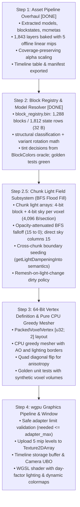

# Voxel Engine Specification & Reference Oracle (Clean-Room Minecraft 26.3)

This document contains mathematically verified invariants, physics equations, graphics formats, and data-oriented layouts extracted from vanilla Minecraft 26.3 client bytecode (`minecraft-26.3-client.jar`).

---

## 1. Physics & Movement Dynamics (20 Hz Fixed Tick)

All simulation ticks run at a fixed $\Delta t = 0.05\text{ s}$ (20 ticks per second).

### Core Constants
- **Base Gravity**: $0.08\text{ blocks/tick}^2$ (`Attributes.GRAVITY = 0.08`)
- **Base Jump Impulse**: $0.42\text{ blocks/tick}$ (`Attributes.JUMP_STRENGTH = 0.42F`)
- **Sprint Jump Boost**: $+0.2\text{ blocks/tick}$ added horizontally in facing direction:
  $$\Delta v_x = -\sin(\theta) \cdot 0.2, \quad \Delta v_z = \cos(\theta) \cdot 0.2$$
- **Vertical Air Drag**: $0.98\text{ per tick}$ ($0.9800000190734863$)
- **Terminal Fall Velocity**: $\approx 3.92\text{ blocks/tick}$ ($\frac{0.08}{1.0 - 0.98}$)
- **Horizontal Air Drag**: $0.91\text{ per tick}$
- **Default Block Friction**: $0.6\text{ (air/standard blocks)}$
- **Effective Ground Friction**: $0.6 \times 0.91 = 0.546\text{ per tick}$
- **Ice Friction**: $0.98 \implies \text{effective friction } = 0.98 \times 0.91 = 0.8918$
- **Ground Acceleration Factor**:
  $$\text{speed\_factor} = \begin{cases} 
  \frac{0.216}{\mu_{\text{block}}^3} & \text{if } \mu_{\text{block}} > 0.6 \\
  1.0 & \text{otherwise}
  \end{cases}$$
- **Fluid Drag**:
  - Water: $0.80\text{ velocity multiplier}$
  - Lava: $0.50\text{ velocity multiplier}$

### Player Dimensions & Bounding Box
- **Width**: $0.6\text{ blocks}$
- **Height (Standing)**: $1.8\text{ blocks}$
- **Eye Height**: $1.62\text{ blocks}$
- **Max Step-Up Height**: $0.6\text{ blocks}$ (`Attributes.STEP_HEIGHT = 0.6`)
- **Relative AABB**: $[-0.3, 0.0, -0.3]$ to $[0.3, 1.8, 0.3]$

### Collision Resolution Order (AABB Sweep)
Collision must be resolved axis-by-axis against neighboring voxel bounding boxes. To prevent corner clipping and sticky corners, modern 26.3 uses dynamic axis ordering:
$$\text{Axis Order} = \begin{cases}
[Y, Z, X] & \text{if } |\Delta x| < |\Delta z| \\
[Y, X, Z] & \text{otherwise}
\end{cases}$$

---

## 2. Terrain Generation & Synthesis (Simplex / Perlin)

- **Simplex 2D Skew Factors**:
  $$F_2 = \frac{\sqrt{3} - 1}{2} \approx 0.3660254037844386$$
  $$G_2 = \frac{3 - \sqrt{3}}{6} \approx 0.21132486540518713$$
- **Standard Deviation Normalization**: $0.42544$
- **Output Range**: Symmetrical $[-2.0, 2.0]$

---

## 3. GPU Texture 2D Array Architecture (`D2Array`)

Rather than a single stitched 2D atlas with bleeding seams, the engine uses a hardware `wgpu::TextureDimension::D2` array texture (`texture_2d_array<f32>` in WGSL):

- **Format**: `wgpu::TextureFormat::Rgba8UnormSrgb`
- **Resolution per Layer**: $16 \times 16\text{ pixels}$
- **Mipmap Levels**: 5 offline levels ($16\times 16 \to 8\times 8 \to 4\times 4 \to 2\times 2 \to 1\times 1$)
  - Downsampled strictly in linear color space ($\text{sRGB} \to \text{linear} \to \text{premultiplied box filter} \to \text{sRGB}$) to eliminate gamma darkening on distant surfaces.
  - Cutout textures use coverage-preserving alpha scaling (Rune Skovbo Johansen's scale factor) to prevent foliage/sapling silhouettes from thinning or vanishing at distance.
- **Layer Budget**:
  - **Static Textures**: 1,246 unique layers.
  - **Animated Frames**: 54 animated textures expanded to all 594 sequential frames.
  - **Base Total**: $1,246 + 594 = 1,840\text{ layers}$.
  - **Pre-Tinted Baked Layers**: 3 duplicate layers for fixed foliage tints (`birch_leaves_tinted` at `0x80A755`, `spruce_leaves_tinted` at `0x619961`, `lily_pad_tinted` at `0x208030`).
  - **Grand Total**: **1,843 layers** (fits comfortably within the 11-bit addressable limit of 2,048 layers).
- **VRAM Footprint**: $\approx 2.40\text{ MB}$ total for all 1,843 layers across all 5 mip levels.
- **Sampler Addressing**: `wgpu::AddressMode::Repeat` tiles greedy-meshed quads naturally across UV coordinates without manual shader modulo or seam artifacts.
- **Non-16px Asset & Flowing Fluid Handling**:
  - 32×32 static assets (signs, shelves) and 64×64 beds are downsampled to 16×16 via 2×2 linear box filtering with cutout preservation.
  - Flowing fluids (`water_flow` 32×1024, `lava_flow` 32×512) have each individual 32×32 frame linearly downsampled to 16×16, preserving all animation frames without distortion.

### Animation Timeline Subsystem
Vertices bake only the base layer index of a texture. All animation timing is resolved on the GPU via a flat timeline buffer in a storage buffer:
- Global `timeline: array<u32>` storing sequences of relative frame indices expanded per tick duration.
- Per-texture lookup: `(timeline_offset, timeline_len, interpolate)`.
- Shader calculation:
  $$\text{frame} = \text{timeline}[\text{timeline\_offset} + (\text{current\_tick} \pmod{\text{timeline\_len}})]$$
  $$\text{layer} = \text{base\_layer} + \text{frame}$$
- Produces tick-accurate, non-linear animation cycles (e.g. `prismarine`, `lava_still`) with zero CPU vertex buffer updates.

---

## 4. Sub-Chunk & Vertex Bit-Packing Specification

### Sub-Chunk Dimensions
- $16 \times 16 \times 16 = 4,096\text{ voxels}$.
- Coordinates span $X \in [0, 16], Y \in [0, 16], Z \in [0, 16]$ (17 corner vertices per axis).

### Vertex Packing: Exactly 64 Bits (`[u32; 2]` / 8 Bytes)
WebGPU and `wgpu` require `arrayStride` to be a multiple of 4 bytes. An 8-byte vertex is hardware-optimal (`R32G32_Uint`), cacheline-aligned (8 vertices per 64-byte cache line), and accommodates full smooth lighting and material attributes.

```
Word 0 (u32): Geometry & Position
 0        4 5        9 10      14 15       17 18       19 20                  31
+----------+----------+----------+-----------+-----------+----------------------+
|  X (5b)  |  Y (5b)  |  Z (5b)  | Normal(3b)| Tint (2b) |     Spare (12b)      |
|  0..=16  |  0..=16  |  0..=16  |   0..5    |   0..3    | (UV rot / flags)     |
+----------+----------+----------+-----------+-----------+----------------------+

Word 1 (u32): Lighting & Material
 0             3 4             7 8       9 10                 20 21           31
+---------------+---------------+---------+--------------------+----------------+
| BlockLight(4b)| SkyLight (4b) | AO (2b) | Base Layer (11b)   |   Spare (11b)  |
|     0..15     |     0..15     |  0..3   |      0..2047       |                |
+---------------+---------------+---------+--------------------+----------------+
```

#### Word 0 Layout:
- **Bits 0..4 (5 bits)**: Local vertex X coordinate ($0..16$).
- **Bits 5..9 (5 bits)**: Local vertex Y coordinate ($0..16$).
- **Bits 10..14 (5 bits)**: Local vertex Z coordinate ($0..16$).
- **Bits 15..17 (3 bits)**: Face Normal direction ID (`0`: $+Y$, `1`: $-Y$, `2`: $+Z$, `3`: $-Z$, `4`: $+X$, `5`: $-X$).
- **Bits 18..19 (2 bits)**: Dynamic Colormap Tint Mode (`0`: None, `1`: Grass colormap, `2`: Foliage colormap, `3`: Water colormap).
- **Bits 20..31 (12 bits)**: Spare / UV rotation flags (e.g. 90° log bark rotation).

#### Word 1 Layout:
- **Bits 0..3 (4 bits)**: Block Light level ($0..15$).
- **Bits 4..7 (4 bits)**: Sky Light level ($0..15$).
- **Bits 8..9 (2 bits)**: Ambient Occlusion level ($0..3 \implies 0.2, 0.45, 0.7, 1.0$).
- **Bits 10..20 (11 bits)**: Texture array base layer index ($0..2047$).
- **Bits 21..31 (11 bits)**: Spare.

### Day-Factor Lighting Invariant
- **No World Re-meshing on Sunset**: Sky light ($0..15$) and block light ($0..15$) are static spatial values baked into Word 1 of vertices.
- **Fragment Shader Lighting Fusion**: A frame uniform `day_factor` ($\in [0.0, 1.0]$) scales the ambient sky contribution in the fragment shader:
  $$\text{Light}_{\text{final}} = \max(\text{block\_light\_color} \times \text{block\_light}, \text{sky\_light\_color} \times (\text{day\_factor} \times \text{sky\_light})) \times \text{AO\_curve}$$
- Day/night progression alters only the uniform scalar; terrain geometry remains 100% untouched.

### Binary Greedy Meshing Merging Invariants
A face quad may merge across adjacent coplanar voxels if and only if:
1. They share identical base texture layer IDs.
2. They share identical face normals.
3. They share identical tint modes.
4. They share identical 4-corner Ambient Occlusion levels.
5. They share identical 4-corner Sky Light and Block Light levels.

### Dynamic Quad Diagonal Flipping (Anisotropy Prevention)
To eliminate diagonal interpolation creases caused by opposing AO and lighting gradients across quad vertices:
$$\text{Gradient}_{02} = (AO_{00} + AO_{11}) + (Light_{00} + Light_{11})$$
$$\text{Gradient}_{01} = (AO_{01} + AO_{10}) + (Light_{01} + Light_{10})$$
$$\text{Triangulation} = \begin{cases}
[1, 2, 3, 3, 0, 1] & \text{if } \text{Gradient}_{02} < \text{Gradient}_{01} \\
[0, 1, 2, 2, 3, 0] & \text{otherwise}
\end{cases}$$

---

## 5. Phase 2 Subsystem Architecture & Dependency Roadmap

### Step 2 (DONE): Offline Block Registry Bake

`crates/asset_pipeline/src/bin/registry_baker.rs` bakes `assets/registry/block_registry.bin`
from `assets/blockstates/` + `assets/models/block/` + `texture_manifest.json`.
The engine loads this as a flat read-only array; it never parses model JSON.

Binary format (little-endian, deterministic — all maps sorted):

| Section | Layout |
|---|---|
| Header (32 B) | `magic "VXRG"` + 7 × u32: `version=1`, `block_count`, `state_count`, `names_len`, reserved ×3 |
| Names blob | UTF-8 block names, concatenated; relative offsets |
| Block index | 20 B/entry: `name_off u32`, `name_len u32`, `state_start u32`, `state_count u32`, `mesh_type u8`, `has_variants u8`, `pad u16` |
| State rows | 32 B `BlockStateEntry` each: `faces[6] FaceInfo` (4 B: `base_layer u16`, `tint_mode u8`, `uv_rot u8`), `mesh_type u8`, `is_opaque u8`, `is_solid u8`, `light_emission u8`, `light_filter u8`, `pad[3]` |

Face slot order: `0 = +Y (UP), 1 = -Y (DOWN), 2 = +Z (SOUTH), 3 = -Z (NORTH), 4 = +X (EAST), 5 = -X (WEST)`.

Classification (`mesh_type`): 0 Empty · 1 Cube · 2 Cross · 3 Fluid · 4 Complex.
Cube = every resolved element is a full `[0,0,0]-[16,16,16]` prism with cullface'd faces and
cullface union covering all 6 directions (handles multi-element stacks like grass_block;
their second "overlay" element is dropped in v1 — base texture wins per cullface).
Empty = entity-rendered blocks (banners, chests, shulkers, skulls, air); they carry property
bytes but no faces.

Variant→face mapping: blockstate variant `x`/`y` are **degrees**, applied
`Rx(x)∘Ry(y)` (Rx first — validated by golden test: `oak_log` axis=x ends on ±X, axis=z
ends on ±Z with `uvlock`-free rotation). Variant values may be dict-form or array-form
(26.3 randomized lists; first entry wins). Face-key fallback covers models omitting
`cullface` on full prisms (piston family).

Tint decisions (provenance: `BlockColors::createDefault()`, snapshot oracle, verified
2026-10-22; constants birch 0x80A755 → layer 1840, spruce 0x619961 → 1841, lily-pad
in-world 0x208030 → 1842):

- `tint_mode 1` grass: fern, short_grass, potted_fern, bush, tall_grass, large_fern,
  grass_block, sugar_cane *(sugar_cane PENDING-VERIFY: BlockTintSources.sugarCane() may
  not equal the pure grass palette)*
- `tint_mode 2` foliage: oak/jungle/acacia/dark_oak leaves, vine, mangrove_leaves.
  **pale_oak_leaves is NOT tinted** (unregistered — fixed texture).
- `tint_mode 3` water: water, bubble_column (fluid rows only).
- `tint_mode 4` dry_foliage: leaf_litter — carried by Word 1 spare bit 0 at mesher packing
  time (registry holds the value; the vertex enum has only 2 bits for 0..3).
- `pink_petals`/`wildflowers` are **NOT grass-tinted** in v1 (BlockColors registers
  `[BLANK, grass]`; petals texture is fixed color; stem-layer tint dropped with cross v1).
- Fixed tints bake directly to pre-tinted layers 1840–1842 with `tint_mode = 0`.

Property bytes v2 (release-jar verified 2026-10-22; oracle table
`assets/registry/block_properties.json` ← `property_extractor.rs` ← decompiled
`Blocks.java`; baker/tests consume the JSON only, never the decompiles):

- **Emission is per-state.** `litBlockEmission(N)` in `Blocks.java` means
  `state.getValue(LIT) ? N : 0`. Exact per-variant rows bake for variant-expanded
  mesh types (furnace/blast_furnace/smoker lit 13·unlit 0, redstone_lamp 15,
  redstone_ore+deepslate 9, redstone_torch 7, candle_cake 3 lit). State-driven
  kinds: `lit_scale` (candle: lit ? 3·CANDLES — CandleBlock.java:42),
  `alive_scale` (sea_pickle: waterlogged ? 3+3·PICKLES), `prop_value`
  (light block = its `level`), `prop_scale` (respawn_anchor = floor(charge/4·15)),
  `prop_map` (vault 6/12 by state; trial_spawner 0/4/8). Weathering copper bulbs:
  lit 15/12/8/4 by oxidation (copper_…/exposed/…/oxidized).
- Constants: lava(15; dampening nonetheless **1**), glowstone/sea_lantern/
  shroomlight/lantern/jack_o_lantern/conduit/beacon/end_portals/froglights 15;
  all torch families 14 (soul 10, redstone lit 7, copper 14); fire 15 / soul_fire 10;
  crying_obsidian 10; nether_portal 11; magma 3; end_portal_frame 1;
  amethyst family 5/4/2/1; sculk sensor 1 / catalyst 6; dragon_egg 1;
  brown_mushroom 1; brewing_stand 1; enchanting_table 7; ender_chest 7;
  glow_lichen 7 (approximation — hasAnyFace λ collapses on the single row);
  glowstone dampening 15 (occludes).
- **Dampening** (attenuation per step — `BlockBehaviour.java:274-280` +
  `LightEngine.getOpacity = max(1, dampening)`): derived rule
  `solidRender ? 15 : propagatesSkylightDown ? 0 : 1` over the registry's
  classification + occlusion set; class overrides harvested: leaves 1 /
  tinted_glass 15; `skylight` set (TransparentBlock family: glass+stained glass,
  grates) → 0. Results: opaque cubes 15; **all fluids incl. lava 1** (the old
  "lava blocks light" value was pre-1.14 folklore; `LiquidBlock.propagatesSkylightDown
  = false` + `.liquid()` ⇒ 1, LightEngine.java:79-81); ice/frosted 1 (no dampening
  override — `HalfTransparentBlock` path) BUT **packed_ice/blue_ice 15** (occluding
  full prisms ⇒ solidRender; no `noOcclusion()` in their registrations);
  slime/honey 1; glass family 0; tinted_glass 15; cross/complex/empty 0.
- `is_opaque` now means canOcclude (full prism ∧ not in `no_occlusion`): glass
  family, leaves, ice/frosted, slime/honey, tinted_glass bake 0. Mesher culling and
  dampening share the same set (both hinge on `noOcclusion()`).
- Canonical-cube rule refined: a model whose elements contain one covering full 16³
  prism (slime/honey inner-juice shell) classifies CUBE; interior texture elements
  drop (same approximation as grass_block overlays).

Step 2.5 invariants for the light field (release-jar mechanics):
- Direct sky column: `(x,z)` columns above the first non-propagating block get
  sky=15 with zero attenuation (`SkyLightEngine` lowestSourceY path).
- Lateral/other propagation: BFS with per-step decrement
  `max(1, dampening(destination))`.
- Section storage: **4,096 B** per 16³ section, one byte per voxel
  `(sky << 4) | block`.
- `getRawBrightness` (LevelLightEngine.java:142-146) is
  `max(blockLight, skyLight − skyDampen)` — a dimension-ambient *subtraction*, NOT
  a day-factor multiply. The shader `day_factor` design mimics the client
  `LightTexture` day ramp; cite it as a client approximation in SPECS.
- Shape gate: `LightEngine.getLightDampeningInto` blocks light 16 when merged
  occlusion faces close the boundary — engages only `useShapeForLightOcclusion`
  blocks (stairs/panes; our complex-skip set) — carried to the Step 2.5 boundary
  propagator when those mesh.
- Section voxel index: `(y << 8) | (z << 4) | x` (x fastest, y slowest) — pinned
  2026-10-22 with the light-field module; mesher and world-gen consume the same order.
- World cover: 24 sections ⇒ Y ∈ [−64, 320); engine constants `MIN_Y = -64`,
  `SECTION_COUNT = 24`. (Vanilla pads `getLightSectionCount() = sections + 2`
  — LevelLightEngine.java:153-155; we skip the padding in v1 but must emulate its
  semantics: light queries at y ≥ MAX_Y yield **sky 15 / block 0** (the vanilla
  padding section above the top is full sky — the mesher's y=319 top faces read
  `sky=15`), y < MIN_Y yields 0/0.)
- State ids: BFS/mesher lookups use raw registry state ids from the bin (see
  approximation 5); no engine-side offset, and lookups by block name in tests.

Known v1 approximations (Step 3/4 refinement list):
1. `uv_rot` uses only the model face's own `rotation` field; blockstate twist with
   `uvlock` re-alignment is not computed (affects mostly complex blocks — fences/stairs).
2. Multi-element cubes keep the FIRST element's texture per cullface (grass_block side
   overlay, slime/honey inner-shell texture dropped).
3. Fluids emit ONE state row regardless of level variants (placement addressing will
   expand when block IDs land).
4. `farmland` (15/16-height top prism) and other near-full prisms classify Complex and
   are mesher-skipped until Step 3 defines near-full handling.
5. `air`/`cave_air`/`void_air` **are** registered rows (air family bakes `MESH_EMPTY`,
   emission 0 / filter 0 / opaque 0 — `assets/blockstates/air.json` is among the 1,288
   blockstates). Engine voxels carry raw registry state ids — **no sentinel/offset**:
   state id `0` is `acacia_button`'s first row, which is *incidentally* all-zero for
   light purposes (an id-0 zero-assert is a vacuous test — always look rows up by
   block name). Unregistered world-voxel ids resolve to `air`'s state id at
   world-import time (Step 5).
6. Complex/Empty blocks stay single-row: LIT-conditioned emitters there (torches,
   campfires, trial/vault/spawner, candle) collapse to always-lit values pending
   light-relevant state expansion ( extractor records carry the predicates; see
   Step 2.5 plan). Crescent emitters like glow_lichen/sea_pickle collapse to their
   representative value with `decl` provenance in the oracle table.
7. Waveforms/variants like respawn_anchor/map from state maps; an unknown
   enumerated value falls back to 0, not a crash.
8. Light reload on edit recomputes the whole chunk column (24 sections) with
   cross-chunk boundary seeding from neighbour light; vanilla's incremental
   add/remove two-queue BFS is deferred until profiling demands it.


