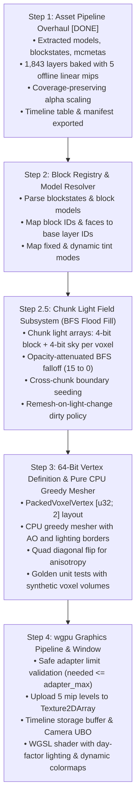

# Voxel Engine Specification & Reference Oracle (Clean-Room Minecraft 26.3)

This document contains mathematically verified invariants, physics equations, graphics formats, and data-oriented layouts extracted from vanilla Minecraft 26.3 client bytecode (`minecraft-26.3-client.jar`).

---

## 1. Physics & Movement Dynamics (20 Hz Fixed Tick)

All simulation ticks run at a fixed $\Delta t = 0.05\text{ s}$ (20 ticks per second).

### Core Constants
- **Base Gravity**: $0.08\text{ blocks/tick}^2$ (`Attributes.GRAVITY = 0.08`)
- **Base Jump Impulse**: $0.42\text{ blocks/tick}$ (`Attributes.JUMP_STRENGTH = 0.42F`)
- **Sprint Jump Boost**: $+0.2\text{ blocks/tick}$ added horizontally in facing direction:
  $$\Delta v_x = -\sin(\theta) \cdot 0.2, \quad \Delta v_z = \cos(\theta) \cdot 0.2$$
- **Vertical Air Drag**: $0.98\text{ per tick}$ ($0.9800000190734863$)
- **Terminal Fall Velocity**: $\approx 3.92\text{ blocks/tick}$ ($\frac{0.08}{1.0 - 0.98}$)
- **Horizontal Air Drag**: $0.91\text{ per tick}$
- **Default Block Friction**: $0.6\text{ (air/standard blocks)}$
- **Effective Ground Friction**: $0.6 \times 0.91 = 0.546\text{ per tick}$
- **Ice Friction**: $0.98 \implies \text{effective friction } = 0.98 \times 0.91 = 0.8918$
- **Ground Acceleration Factor**:
  $$\text{speed\_factor} = \begin{cases} 
  \frac{0.216}{\mu_{\text{block}}^3} & \text{if } \mu_{\text{block}} > 0.6 \\
  1.0 & \text{otherwise}
  \end{cases}$$
- **Fluid Drag**:
  - Water: $0.80\text{ velocity multiplier}$
  - Lava: $0.50\text{ velocity multiplier}$

### Player Dimensions & Bounding Box
- **Width**: $0.6\text{ blocks}$
- **Height (Standing)**: $1.8\text{ blocks}$
- **Eye Height**: $1.62\text{ blocks}$
- **Max Step-Up Height**: $0.6\text{ blocks}$ (`Attributes.STEP_HEIGHT = 0.6`)
- **Relative AABB**: $[-0.3, 0.0, -0.3]$ to $[0.3, 1.8, 0.3]$

### Collision Resolution Order (AABB Sweep)
Collision must be resolved axis-by-axis against neighboring voxel bounding boxes. To prevent corner clipping and sticky corners, modern 26.3 uses dynamic axis ordering:
$$\text{Axis Order} = \begin{cases}
[Y, Z, X] & \text{if } |\Delta x| < |\Delta z| \\
[Y, X, Z] & \text{otherwise}
\end{cases}$$

---

## 2. Terrain Generation & Synthesis (Simplex / Perlin)

- **Simplex 2D Skew Factors**:
  $$F_2 = \frac{\sqrt{3} - 1}{2} \approx 0.3660254037844386$$
  $$G_2 = \frac{3 - \sqrt{3}}{6} \approx 0.21132486540518713$$
- **Standard Deviation Normalization**: $0.42544$
- **Output Range**: Symmetrical $[-2.0, 2.0]$

---

## 3. GPU Texture 2D Array Architecture (`D2Array`)

Rather than a single stitched 2D atlas with bleeding seams, the engine uses a hardware `wgpu::TextureDimension::D2` array texture (`texture_2d_array<f32>` in WGSL):

- **Format**: `wgpu::TextureFormat::Rgba8UnormSrgb`
- **Resolution per Layer**: $16 \times 16\text{ pixels}$
- **Mipmap Levels**: 5 offline levels ($16\times 16 \to 8\times 8 \to 4\times 4 \to 2\times 2 \to 1\times 1$)
  - Downsampled strictly in linear color space ($\text{sRGB} \to \text{linear} \to \text{premultiplied box filter} \to \text{sRGB}$) to eliminate gamma darkening on distant surfaces.
  - Cutout textures use coverage-preserving alpha scaling (Rune Skovbo Johansen's scale factor) to prevent foliage/sapling silhouettes from thinning or vanishing at distance.
- **Layer Budget**:
  - **Static Textures**: 1,246 unique layers.
  - **Animated Frames**: 54 animated textures expanded to all 594 sequential frames.
  - **Base Total**: $1,246 + 594 = 1,840\text{ layers}$.
  - **Pre-Tinted Baked Layers**: 3 duplicate layers for fixed foliage tints (`birch_leaves_tinted` at `0x80A755`, `spruce_leaves_tinted` at `0x619961`, `lily_pad_tinted` at `0x208030`).
  - **Grand Total**: **1,843 layers** (fits comfortably within the 11-bit addressable limit of 2,048 layers).
- **VRAM Footprint**: $\approx 2.40\text{ MB}$ total for all 1,843 layers across all 5 mip levels.
- **Sampler Addressing**: `wgpu::AddressMode::Repeat` tiles greedy-meshed quads naturally across UV coordinates without manual shader modulo or seam artifacts.
- **Non-16px Asset & Flowing Fluid Handling**:
  - 32×32 static assets (signs, shelves) and 64×64 beds are downsampled to 16×16 via 2×2 linear box filtering with cutout preservation.
  - Flowing fluids (`water_flow` 32×1024, `lava_flow` 32×512) have each individual 32×32 frame linearly downsampled to 16×16, preserving all animation frames without distortion.

### Animation Timeline Subsystem
Vertices bake only the base layer index of a texture. All animation timing is resolved on the GPU via a flat timeline buffer in a storage buffer:
- Global `timeline: array<u32>` storing sequences of relative frame indices expanded per tick duration.
- Per-texture lookup: `(timeline_offset, timeline_len, interpolate)`.
- Shader calculation:
  $$\text{frame} = \text{timeline}[\text{timeline\_offset} + (\text{current\_tick} \pmod{\text{timeline\_len}})]$$
  $$\text{layer} = \text{base\_layer} + \text{frame}$$
- Produces tick-accurate, non-linear animation cycles (e.g. `prismarine`, `lava_still`) with zero CPU vertex buffer updates.

---

## 4. Sub-Chunk & Vertex Bit-Packing Specification

### Sub-Chunk Dimensions
- $16 \times 16 \times 16 = 4,096\text{ voxels}$.
- Coordinates span $X \in [0, 16], Y \in [0, 16], Z \in [0, 16]$ (17 corner vertices per axis).

### Vertex Packing: Exactly 64 Bits (`[u32; 2]` / 8 Bytes)
WebGPU and `wgpu` require `arrayStride` to be a multiple of 4 bytes. An 8-byte vertex is hardware-optimal (`R32G32_Uint`), cacheline-aligned (8 vertices per 64-byte cache line), and accommodates full smooth lighting and material attributes.

```
Word 0 (u32): Geometry & Position
 0        4 5        9 10      14 15       17 18       19 20                  31
+----------+----------+----------+-----------+-----------+----------------------+
|  X (5b)  |  Y (5b)  |  Z (5b)  | Normal(3b)| Tint (2b) |     Spare (12b)      |
|  0..=16  |  0..=16  |  0..=16  |   0..5    |   0..3    | (UV rot / flags)     |
+----------+----------+----------+-----------+-----------+----------------------+

Word 1 (u32): Lighting & Material
 0             3 4             7 8       9 10                 20 21           31
+---------------+---------------+---------+--------------------+----------------+
| BlockLight(4b)| SkyLight (4b) | AO (2b) | Base Layer (11b)   |   Spare (11b)  |
|     0..15     |     0..15     |  0..3   |      0..2047       |                |
+---------------+---------------+---------+--------------------+----------------+
```

#### Word 0 Layout:
- **Bits 0..4 (5 bits)**: Local vertex X coordinate ($0..16$).
- **Bits 5..9 (5 bits)**: Local vertex Y coordinate ($0..16$).
- **Bits 10..14 (5 bits)**: Local vertex Z coordinate ($0..16$).
- **Bits 15..17 (3 bits)**: Face Normal direction ID (`0`: $+Y$, `1`: $-Y$, `2`: $+Z$, `3`: $-Z$, `4`: $+X$, `5`: $-X$).
- **Bits 18..19 (2 bits)**: Dynamic Colormap Tint Mode (`0`: None, `1`: Grass colormap, `2`: Foliage colormap, `3`: Water colormap).
- **Bits 20..31 (12 bits)**: Spare / UV rotation flags (e.g. 90° log bark rotation).

#### Word 1 Layout:
- **Bits 0..3 (4 bits)**: Block Light level ($0..15$).
- **Bits 4..7 (4 bits)**: Sky Light level ($0..15$).
- **Bits 8..9 (2 bits)**: Ambient Occlusion level ($0..3 \implies 0.2, 0.45, 0.7, 1.0$).
- **Bits 10..20 (11 bits)**: Texture array base layer index ($0..2047$).
- **Bits 21..31 (11 bits)**: Spare.

### Day-Factor Lighting Invariant
- **No World Re-meshing on Sunset**: Sky light ($0..15$) and block light ($0..15$) are static spatial values baked into Word 1 of vertices.
- **Fragment Shader Lighting Fusion**: A frame uniform `day_factor` ($\in [0.0, 1.0]$) scales the ambient sky contribution in the fragment shader:
  $$\text{Light}_{\text{final}} = \max(\text{block\_light\_color} \times \text{block\_light}, \text{sky\_light\_color} \times (\text{day\_factor} \times \text{sky\_light})) \times \text{AO\_curve}$$
- Day/night progression alters only the uniform scalar; terrain geometry remains 100% untouched.

### Binary Greedy Meshing Merging Invariants
A face quad may merge across adjacent coplanar voxels if and only if:
1. They share identical base texture layer IDs.
2. They share identical face normals.
3. They share identical tint modes.
4. They share identical 4-corner Ambient Occlusion levels.
5. They share identical 4-corner Sky Light and Block Light levels.

### Dynamic Quad Diagonal Flipping (Anisotropy Prevention)
To eliminate diagonal interpolation creases caused by opposing AO and lighting gradients across quad vertices:
$$\text{Gradient}_{02} = (AO_{00} + AO_{11}) + (Light_{00} + Light_{11})$$
$$\text{Gradient}_{01} = (AO_{01} + AO_{10}) + (Light_{01} + Light_{10})$$
$$\text{Triangulation} = \begin{cases}
[1, 2, 3, 3, 0, 1] & \text{if } \text{Gradient}_{02} < \text{Gradient}_{01} \\
[0, 1, 2, 2, 3, 0] & \text{otherwise}
\end{cases}$$

---

## 5. Phase 2 Subsystem Architecture & Dependency Roadmap


